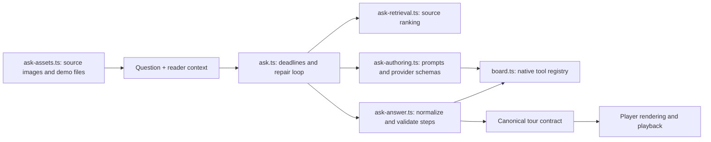

# Code and agent architecture audit — 29 October 2026

The audit focused on agent extension points, dependency direction, duplicated validation, unused paths and the largest application modules. It did not change prompts, model budgets, persisted tour formats or playback behavior.

## Refactorings completed

| Finding | Change |
| --- | --- |
| Q&A mixed retrieval, provider authoring, validation, file access and orchestration in 1,280 lines. | Separate cohesive modules; `ask.ts` now contains the request workflow and service error mapping in about 225 lines. Existing imports remain compatible through explicit exports. |
| Visual kinds, validation dispatch and focus catalogs were repeated across tours, examples and Q&A. | One typed `BOARD_TOOLS` registry owns native tool schemas, validators and focus-part identities. Consumers derive their kind lists from it. Adding a `BoardItem` kind makes an incomplete registration a compile error. |
| Numeric examples validated a calculation and then parsed/evaluated it again with a second tolerance calculation to store its value. | One internal result supplies both the diagnostic and the exact value carried into later calculations. The public diagnostic API remains unchanged. |
| Retrieval imported a large authoring module merely to extract table text. | Pure table-text extraction lives in `shared/tableTargets.ts`; retrieval no longer imports tool authoring. |
| `boardRepair` had no callers after complete-direction repair replaced it. | Removed the unused repair function and its import. The active bounded repair loops remain intact. |

No dependencies or generic plugin/workflow framework were added. The older Muse writer is still configurable and covered by integration tests; it is not dead code. Native renderer branches and canonical schemas remain explicit because they serve different responsibilities from model authoring.

## Q&A boundaries

- `ask-types.ts` contains the request/answer contracts without importing the workflow.
- Retrieval is deterministic and makes no model or storage requests.
- Authoring owns the provider's wire format, including its nesting adaptations. These adaptations do not weaken canonical local validation.
- Answer conversion owns grounded actions, speech anchors, example verification and conversion into canonical steps.
- The workflow alone owns provider calls, cancellation, deadlines, attempt budgets and repair messages.
- Source I/O retains the existing file-containment checks, byte limits and optional-image deadline.

## Adding or improving a visualization

1. Define its canonical data and validation in `shared/` and the saved-tour schema when the persisted format changes. Keep the discriminated `BoardItem` union as the contract with the reader.
2. Register the provider schema, local validator and focus IDs/order in `server/src/harness/board.ts`. Tours and worked examples automatically use the registered kind catalog. `boardParts`, `boardPartIds` and `boardPart` derive from the same registration.
3. Update the typed teaching instructions/examples in `prompts.ts`. Explain when the visual adds insight; registration does not imply the agent should always choose it.
4. If the new kind needs a different Q&A wire shape or speech-anchor mapping, add that explicit adapter in `ask-authoring.ts` and `ask-answer.ts`. Do not make core validators depend on Q&A-specific provider fields.
5. Implement the renderer and playback interpolation in the player. Reuse canonical data and preserve pause/seek semantics.
6. Add a fixture to `board-registry.test.ts` and cover the actual geometry/transformation in the relevant renderer tests. Exercise tour and Q&A conversion before a real model quality check.

For workflow changes, keep retries and cancellation in the orchestrator. Improve retrieval without modifying model transport; improve a tool validator without changing the request lifecycle. A new workflow stage should produce explicit checked data and actionable diagnostics rather than hiding another model call inside a validator.

## Verification and limits

- All five provider tool schemas and their offered focus catalogs were compared directly with the committed baseline and matched. Reordered flow-node focus retains the original identity mapping.
- Full test suite passed: all player suites and ingestion 61 passed with 1 existing skip. The final server run, including the new registry contract tests, passed 276 tests with 7 existing skips.
- Production build passed. A static runtime-import graph check over 82 backend/shared source modules found no cycles; type-only imports were excluded.
- No paid model generation was needed for this structural refactor. These checks establish contract preservation, not a new claim about generated pedagogical quality.
- `Reader.tsx` and `GenerationActivity.tsx` remain sizeable UI modules. A later focused refactor should isolate playback/camera coordination and the activity detail panel with interaction tests. This audit avoids mixing that UI lifecycle change into the agent refactor.
